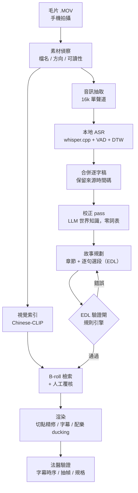

# vediocut — 逐字稿優先的 AI Vlog 剪輯系統

> **Case study.** vediocut turns a pile of handheld phone clips into a narrative vlog by
> *understanding what was said first* and only then deciding how to cut. It combines local
> ASR, an LLM correction pass that uses world knowledge instead of hand-built glossaries,
> chronological "radio-edit" story planning, CLIP-based B-roll retrieval with human review,
> and a deterministic validation layer before rendering. This repo documents the method,
> architecture and engineering lessons from nine real projects; the source code is private.

**一句話**：把一堆手機毛片變成一支有故事的 Vlog——先聽懂人在說什麼，再決定怎麼剪。

本 repo 是**案例研究（展示版）**：說明問題、方法、架構與工程決策。不含原始碼、拍攝素材、
逐字稿與成片。

---

## 問題

自動剪輯常見的做法是依鏡頭或時間切段：偵測場景變化、取固定長度、湊滿目標片長。
早期原型就是這樣做的——它驗證了轉碼、混音與輸出都能動，但成品不能看：

- 句子在說到一半時被切斷
- 時間相鄰但內容無關的片段被接在一起
- B-roll 只對得上時間，對不上正在講的東西
- 平均片段長度看似合理，卻沒有事件鋪陳，也沒有結果

**根因是順序錯了**：先決定畫面再理解內容。人類剪輯師是反過來的——先聽懂素材在說什麼、
找出故事，畫面最後才補。

素材本身也不友善：手持自拍、邊走邊講、街道與餐廳的環境音、中文口語夾雜英文、
大量同音誤聽（店名與路名尤其嚴重）。

## 做法

十二個步驟、每步都有驗收條件。完整說明見 [`docs/01-architecture.md`](docs/01-architecture.md)。

## 五個核心設計決策

### 1. 逐字稿優先，radio edit 先成立
先只用聲音剪出一版（radio edit），**把畫面關掉也要聽得懂**這支片發生了什麼。畫面、
B-roll、音樂都是後加的。選段只能落在句尾或自然停頓，時間順序不重排（唯一例外是片頭的
精華預告）。→ [`docs/02-editorial-method.md`](docs/02-editorial-method.md)

### 2. 校正用世界知識，不建詞表
ASR 錯字的大宗是專有名詞的同音誤聽。直覺做法是人工建詞表，實測反而**有害**：詞表把
協調者的猜測固化成下游的權威依據——同一批素材，小模型＋人工詞表修正 8 筆且其中一筆
照錯詞表改錯；較強的模型＋**零詞表**修正 17 筆。改成讓模型先從逐字稿推斷地區與領域、
再用該脈絡的知識還原，prompt 裡刻意不寫死任何地區。→ [`docs/03-asr-correction.md`](docs/03-asr-correction.md)

### 3. B-roll 寧缺勿錯，人工覆核優先於相似度分數
CLIP 檢索在「同一場景的自拍講話」這類同質素材上會系統性失效——它只能判斷「這些都是
街景」。相似度落在 0.42–0.55 的候選大多是「人臉近似人臉」。但分數低也不代表錯：曾有一個
0.45 的候選畫面上清楚寫著台詞正在講的店名。**分數只是篩子，判斷要靠抽幀覆核。**
→ [`docs/04-broll-retrieval.md`](docs/04-broll-retrieval.md)

### 4. LLM 負責判斷，規則引擎負責把關
故事規劃交給模型，但產出的剪輯決策表（EDL）必須先過一道確定性的驗證閘：切點是否
對齊語句邊界、同素材是否回頭、片段是否超出素材長度、必留內容是否都在。驗證不過
不准渲染。

### 5. 讓失敗大聲
九個專案裡最貴的 bug 都是**靜默失敗**：缺套件時切點精修默默跳過、檢索融合因 import
路徑問題默默關閉、檔案「看起來存在」但讀不到內容。每一個都被改成會明講原因的檢查。
→ [`docs/05-reliability.md`](docs/05-reliability.md)

## 成果

在九個真實拍攝專案上迭代驗證（美食探店、生活日常、街區導覽等類型）：

| 指標 | 數值 |
|---|---|
| 專案數 | 9 |
| 處理素材 | 220 支有口白的片段 |
| 累計口白 | 約 122 分鐘 |
| 成片長度 | 1.5–20 分鐘（依類型與素材量） |
| 單專案校正筆數 | 最多 47 筆，guardrail 零誤擋 |
| 敘事模板 | 9 種（探店、日常、旅遊、開箱、商品、心得、解說、房仲、場所導覽） |

壓縮比從約 7 : 1 到接近 1 : 1，差距來自素材本身：有大量點餐雜訊與重複說明的素材可以
壓得很多；邊走邊講的街區導覽旁白本來就很緊，硬壓縮等於砍掉內容。另一個方向的校準來自
使用者回饋——某一版被評為「剪得太嚴謹」，被剪掉的四段其實都是專名被聽錯、還原後完全
通順的推薦。**片長應由內容決定，而不是預設目標。**

## 學到的事

- **最強的訊號常常在畫面裡。** 店名的同音推理再怎麼合理，都比不上招牌入鏡。校正流程
  後來明訂：可疑詞先試還原 → 再抽幀或搜尋驗證 → 語意可推斷就照播 → 只有真的會誤導觀眾才剪。
- **「我看不懂」不等於「該剪掉」。** 早期規則是語意不明就避開，結果誤剪了好幾段有價值的
  推薦——它們只是專名被聽錯，還原後完全通順。
- **小規模能過的假設，會在大規模時一次現形。** 片長從 5 分鐘變成 20 分鐘，固定的逾時值
  就失效；素材從 9 支變成 46 支，「每支都讀得到」的假設就破了。
- **代理回報「完成」不等於完成。** 校正代理曾在報告中聲稱修了某一筆，但寫進結果檔的內容
  與原文一字不差。協調者必須自己重跑驗收。
- **效能問題要先量再猜。** 視覺索引一度被認為「程式有問題」，量測後發現 79 分鐘牆鐘只用了
  1.27 秒 CPU——它根本不是在算，是在等一顆 97% 滿的磁碟。

## 技術棧

| 層 | 選用 |
|---|---|
| ASR | whisper.cpp（large-v3-turbo q8_0）＋ Silero VAD ＋ DTW token 級時間碼，全本地 |
| 校正 / 規劃 | Claude（Sonnet 級模型處理批次校正，協調者覆核） |
| 視覺檢索 | Chinese-CLIP（ViT-B/16），原生中文文字塔 |
| 切點精修 | 能量谷分析（numpy / librosa） |
| 渲染 | FFmpeg / libx264，多 pass 拆解 filtergraph，libass 字幕 |
| 服務 | Python、FastAPI、非破壞式 EDL |

## 文件導覽

| 文件 | 內容 |
|---|---|
| [`01-architecture.md`](docs/01-architecture.md) | 十二步 pipeline、模組職責、資料契約 |
| [`02-editorial-method.md`](docs/02-editorial-method.md) | 逐字稿優先的剪輯方法、敘事模板設計 |
| [`03-asr-correction.md`](docs/03-asr-correction.md) | 世界知識校正、地區中性 prompt、guardrail |
| [`04-broll-retrieval.md`](docs/04-broll-retrieval.md) | 視覺檢索的極限與人工覆核準則 |
| [`05-reliability.md`](docs/05-reliability.md) | 十個真實 bug 與「讓失敗大聲」的修法 |

## 開發方式

以 Claude Code 為協作夥伴開發：產品方向、剪輯判斷標準與每一個取捨由我決定，
實作與大量迭代驗證透過 AI 協作完成。這個合作方式本身也成為系統設計的一部分——
校正 pass 就是「多個代理平行處理、協調者覆核」的結構。

---

© 2026 Leo. All rights reserved. 本 repo 為作品展示，未授權重製或商業使用。
