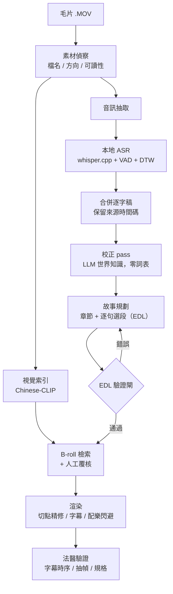

# vediocut — 逐字稿優先的 AI Vlog 剪輯工具

> **Open source (MIT).** vediocut turns a folder of handheld phone clips into a narrative vlog
> by *understanding what was said first* and only then deciding how to cut. Local ASR
> (whisper.cpp), an LLM correction pass that uses world knowledge instead of hand-built
> glossaries, chronological "radio-edit" planning, CLIP-based B-roll retrieval with human
> review, and a deterministic validation gate before rendering. Designed to be driven by
> [Claude Code](https://claude.com/claude-code); macOS only for now. Docs are in Traditional Chinese.

**一句話**：把一資料夾的手機毛片剪成一支有故事的 Vlog——先聽懂人在說什麼，再決定怎麼剪。

- **逐字稿優先**：先轉錄、再規劃故事，關掉畫面只聽聲音也要聽得懂
- **專名還原靠世界知識**：不用建詞表，模型從逐字稿自己推斷地區與領域，還原店名、路名的同音誤聽
- **輸出完整成片**：1080p、燒錄字幕、配樂自動閃避人聲、片頭精華預告、選用的 B-roll 補畫面
- **每一步都有驗收**：EDL 驗證閘、切點能量精修、環境體檢腳本，失敗會大聲說出原因
- **全本地 ASR**：素材與聲音不離開你的電腦（校正 pass 可選擇用 API 或 Claude Code）

---

## 快速開始

### 需求

| 項目 | 說明 |
|---|---|
| 系統 | **macOS**（字型與工具鏈目前寫死 macOS；已在 Apple Silicon 上驗證） |
| ffmpeg | 需編入 **libass**（燒字幕用）。注意 Homebrew 的一般 `ffmpeg` 9.x 沒有 libass，要裝 `ffmpeg-full` |
| whisper.cpp | 提供 `whisper-cli`，需支援 `--dtw` |
| Python | 3.10–3.13（torch 尚未支援更新的版本） |
| 磁碟 | 工具本身約 3 GB（Python 環境 1.2 GB、ASR 模型 0.9 GB、視覺模型 0.7 GB）；每支片另需約素材大小 2 倍的中繼檔空間 |
| [Claude Code](https://claude.com/claude-code) | 建議。故事規劃（逐字稿 → 剪輯決策）由它完成；不用的話要自己寫 EDL |

> ⚠ **不要把專案放在 `~/Desktop` 或 `~/Documents`**。若開著 iCloud「桌面與文件」同步，
> 磁碟吃緊時素材與模型會被清成「有大小、無內容」的佔位檔，流程會在中途莫名失敗。
> 放 `~/Developer` 或外接硬碟。

### 安裝

```bash
brew install ffmpeg-full whisper-cpp
```

`ffmpeg-full` 是 keg-only，不會自動加進 PATH，要自己加（寫進 `~/.zshrc` 才會保留）：

```bash
export PATH="$(brew --prefix ffmpeg-full)/bin:$PATH"
```

```bash
git clone https://github.com/leoai123/vediocut-case-study.git ~/Developer/vediocut
cd ~/Developer/vediocut
```

```bash
python3.13 -m venv .venv && .venv/bin/pip install -r requirements.txt
```

```bash
scripts/setup_models.sh
```

下載 ASR 模型並以官方 checksum 驗證。視覺模型（Chinese-CLIP）會在第一次建索引時自動下載。

```bash
scripts/doctor.sh
```

環境體檢：逐項確認工具、套件、模型都**實際可用**（不只是存在），出現 ✗ 就先處理。

### 剪第一支片（用 Claude Code）

1. 把素材放進 `footage/<名稱>/`（`.MOV`，檔名不可有空格；可另放一兩首 `.mp3` 當配樂）
2. 在這個資料夾開啟 Claude Code，說：

   > 用 vediocut 把 `footage/myvlog` 剪成一支 vlog

Claude Code 會讀取 [`.claude/skills/vediocut-flow/SKILL.md`](.claude/skills/vediocut-flow/SKILL.md)，
依十二步流程執行：素材偵察 → 開案 → 抽音訊 → 轉錄 → 校正 → 視覺索引 → 故事規劃 → 驗證
→ B-roll → 渲染 → 法醫驗證。每一步過了驗收條件才進下一步。

成片在 `output/<名稱>/final.mp4`，字幕檔 `final.srt`。

---

## 手動執行（不用 Claude Code）

流程裡只有**故事規劃**需要判斷力，其餘都是指令。以專案 `myvlog`、素材在 `footage/myvlog/` 為例：

```bash
scripts/new_project.sh myvlog footage/myvlog daily --lang zh
```

第三個參數是敘事模板（選用）：`food` `daily` `travel` `place` `unboxing` `product` `talking`
`explainer` `realestate`，各模板的適用情境見 [`templates/`](templates/)。`--lang` 支援 `zh`、`en`。

```bash
scripts/prepare_p1_audio.sh myvlog
```

```bash
scripts/transcribe_p1_perfile.sh myvlog
```

```bash
python3 scripts/merge_transcript.py --project myvlog
```

**校正 pass**（不可跳過，否則字幕會帶著整片的同音錯字）。有 API key 的話：

```bash
set -a; source .env; set +a
```

```bash
python3 scripts/correct_transcript.py --project myvlog --dry
```

確認差異沒問題後拿掉 `--dry` 寫回。沒有 API key 時用 `--emit-batches` 匯出批次檔，交給任何 LLM
處理後用 `--apply` 套回，細節見 skill 第 6 步。

**故事規劃**：讀 `analysis/myvlog/transcript.json`，寫出 `analysis/myvlog/edit_decision.json`。
格式與最小範例見 [`docs/edl-format.md`](docs/edl-format.md)，剪輯原則見
[`docs/02-editorial-method.md`](docs/02-editorial-method.md)。

```bash
python3 scripts/validate_edl.py --project myvlog
```

```bash
.venv/bin/python scripts/render_p1.py --project myvlog --preview
```

`--preview` 是 720p 快速模式，調整 EDL 時用；拿掉就是 1080p 正式版。

選用步驟：

| 指令 | 用途 |
|---|---|
| `.venv/bin/python app/visual_index.py build --project myvlog --model v2` | 建視覺索引（B-roll 檢索的前置） |
| `.venv/bin/python app/broll_engine.py --project myvlog --v2 --dry` | 列出 B-roll 候選；確認後拿掉 `--dry` 寫進 EDL |
| `.venv/bin/python app/music_beats.py --project myvlog` | 分析配樂節拍，B-roll 切點會對齊拍點 |

**長流程一律用 `.venv/bin/python`**。系統 Python 缺數值套件時，切點精修會靜默降級，字尾容易被切掉。

### 配樂

- EDL 寫 `"music": {"file": "bgm.mp3"}` → 用該首；檔案不存在會直接報錯
- 不寫 `music` → 自動用素材資料夾裡的第一首 `.mp3`；一首都沒有就無配樂
- `"music": false` → 明確不要配樂

配樂會在人聲出現時自動壓低（sidechain ducking）。

### 剪輯介面

```bash
python3 app/edit_server.py
```

打開 http://127.0.0.1:8766 ：預覽成片、調整片段、重新驗證與渲染。伺服器只用 Python 標準庫，
系統 `python3` 就能啟動；按下渲染時會自動改用 `.venv` 的 Python。

---

## 它怎麼運作



### 五個核心設計決策

1. **逐字稿優先，radio edit 先成立**——先只用聲音剪出一版，畫面、B-roll、音樂都是後加的。
   選段只落在句尾，時間順序不重排（唯一例外是片頭預告）
2. **校正用世界知識，不建詞表**——實測人工詞表反而有害：小模型＋詞表修正 8 筆且其中一筆照錯詞表
   改錯；較強的模型＋零詞表修正 17 筆。prompt 裡也刻意不寫死任何地區
3. **B-roll 寧缺勿錯**——CLIP 在「同一場景的自拍講話」這類素材上會系統性失效。分數只是篩子，
   判斷靠抽幀覆核：曾有一個分數只有 0.45 的候選，畫面上就寫著台詞正在講的店名
4. **LLM 負責判斷，規則引擎負責把關**——剪輯決策表先過確定性的驗證閘才准渲染
5. **讓失敗大聲**——最貴的 bug 都是靜默失敗：缺套件時精修默默跳過、檔案「看起來存在」但讀不到。
   每一個都改成會明講原因的檢查

完整說明：

| 文件 | 內容 |
|---|---|
| [`01-architecture.md`](docs/01-architecture.md) | 十二步 pipeline、模組職責、資料契約、渲染與字幕時序 |
| [`02-editorial-method.md`](docs/02-editorial-method.md) | 剪輯方法、規劃檢查清單、敘事模板設計 |
| [`03-asr-correction.md`](docs/03-asr-correction.md) | 世界知識校正、地區中性 prompt、guardrail、協調者覆核 |
| [`04-broll-retrieval.md`](docs/04-broll-retrieval.md) | 視覺檢索的極限與人工覆核準則 |
| [`05-reliability.md`](docs/05-reliability.md) | 真實發生的 bug 與「讓失敗大聲」的修法 |
| [`edl-format.md`](docs/edl-format.md) | 剪輯決策表格式與驗證規則 |

---

## 開發歷程與成果

這套工具在九個真實拍攝專案上迭代出來（美食探店、生活日常、街區導覽等），
累計處理 220 支有口白的片段、約 122 分鐘口白，成片長度 1.5–20 分鐘。程式碼註解裡的
`p1`–`p9` 指的就是這些內部測試專案（素材未公開），用來標明每條規則是從哪次事故長出來的。

壓縮比從約 7 : 1 到接近 1 : 1，差距來自素材本身：有大量點餐雜訊的素材能壓很多，邊走邊講的
導覽旁白本來就很緊。**片長應由內容決定，而不是預設目標。**

## 已知限制

- **只支援 macOS**：字幕與片頭字卡寫死 macOS 系統字型（PingFang TC、STHeiti），工具鏈以 Homebrew 為準
- **故事規劃需要 LLM 在迴圈中**：沒有一鍵全自動；用 Claude Code 最順，或自己寫 EDL
- **只吃 `.MOV`**：其他格式（如螢幕錄影 `.mp4`）會被忽略，要先轉檔
- **以中文素材為主**：英文已支援，但驗證量遠少於中文
- **B-roll 自動檢索在同質素材上效果有限**：整支都是自拍講話時，多半靠人工挑選

## 疑難排解

| 現象 | 原因與處理 |
|---|---|
| 字幕燒不上去、`No such filter: 'subtitles'` | ffmpeg 沒有 libass。裝 `ffmpeg-full` 並加進 PATH，跑 `scripts/doctor.sh` 確認 |
| 轉錄全部失敗、`invalid model data` | 模型檔讀不出內容，多半是雲端同步的佔位檔。`scripts/doctor.sh` 會指出來 |
| 抽音訊時出現 `apac ... unknown codec` | iPhone 的空間音訊軌，無害——流程只取第一條一般音軌 |
| 視覺索引或渲染極慢 | 磁碟太滿（>90%）。實測曾 79 分鐘只用掉 1.27 秒 CPU，全在等磁碟 |
| 字尾被切掉 | 用了系統 Python。改用 `.venv/bin/python` |

## 目錄結構

```
app/          核心模組：專案路徑契約、視覺索引、B-roll 引擎、LLM 介面、剪輯介面伺服器
scripts/      流程腳本：開案、抽音訊、轉錄、合併、校正、驗證、渲染、體檢、模型下載
templates/    九種敘事模板（適用情境、章節骨架、選段原則、B-roll 準則）
docs/         設計文件
.claude/      Claude Code skill：十二步 runbook
footage/      放你的素材（不進版控）
analysis/     每支片的逐字稿與剪輯決策（執行時產生，不進版控）
output/       成片（執行時產生，不進版控）
models/       ASR 模型（setup_models.sh 下載，不進版控）
```

`footage/`、`analysis/`、`output/` 是你的私人資料（臉、聲音、去過的地方），已在
`.gitignore`。fork 之後若要提交它們，請確認你真的想公開。

## 開發方式

以 Claude Code 為協作夥伴開發：產品方向、剪輯判斷標準與每一個取捨由我決定，實作與大量
迭代驗證透過 AI 協作完成。這個合作方式本身也成為系統設計的一部分——校正 pass 就是
「多個代理平行處理、協調者覆核」的結構。

歡迎 issue 與 PR，特別是：Linux 支援、非 `.MOV` 格式、不依賴 Claude Code 的自動規劃器。

## 授權

[MIT](LICENSE)。ASR 模型（whisper.cpp）與視覺模型（Chinese-CLIP）由各自的專案提供，
執行時才下載，不隨本 repo 散布。
