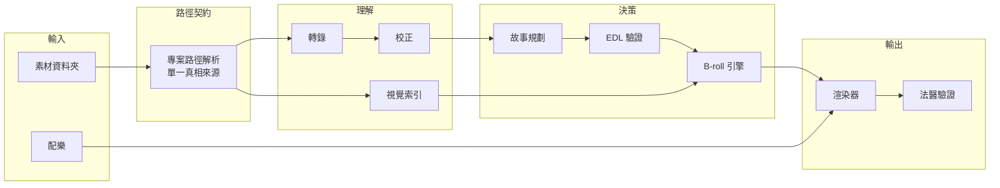

# 01 · 架構

## 十二步 pipeline

每一步都有明確的**驗收條件**，過了才進下一步。這份 runbook 本身就是從事故中長出來的——
例如「校正 pass 不可跳過」這條，是因為有一版成片帶著整片未校正的錯字輸出，全部 321 段
都沒被修過。

| # | 步驟 | 產出 | 驗收條件 |
|---|---|---|---|
| 1 | 素材偵察 | 時長、編碼、方向、檔名體檢 | 方向與檔名都已過檢；非支援容器已排除 |
| 2 | 開案 | 專案 manifest、設定檔 | 解析度、模板、語言已設定；詞表留空 |
| 3 | 音訊抽取 | 每支素材一個 16k 單聲道音檔 | 音檔數 = 素材數（讀不到的明確列出） |
| 4 | 轉錄 | 每支素材一份原始 ASR | 數量到齊、模型實際可讀 |
| 5 | 合併 | 統一逐字稿 | segment 非空，記下總口白秒數 |
| 6 | 校正 pass | 校正後逐字稿（保留原文） | 改動數 > 0、長度異常全部覆核、低信心記錄在案 |
| 7 | 視覺索引 | 抽幀 embedding | 資產數與素材數一致 |
| 8 | 故事規劃 | 敘事規劃 + 剪輯決策表（EDL） | 重複句、銜接、環境音污染、可疑詞都有處置紀錄 |
| 9 | EDL 驗證 | 錯誤 / 警告清單 | 錯誤 0；每條警告讀懂原因 |
| 10 | B-roll | 覆蓋決策 | 每個窗口抽幀覆核；拒絕理由記錄在案 |
| 11 | 渲染 | 成片 + 字幕檔 | 切點精修零降級；時長在預估範圍 |
| 12 | 法醫驗證 | — | 字幕時序、抽幀、規格三項全過才可交付 |

## 系統組成

### 路徑契約：單一真相來源
所有腳本都透過同一個模組解析「這個專案的素材在哪、分析產物在哪、暫存在哪」，不准自己
拼路徑。這是在支援多專案之後補上的——在那之前，各腳本各自假設目錄結構，換一個專案就有
腳本找錯地方。這個模組的命令列輸出被標為**穩定契約**並列出所有消費者，改格式前必須同步更新。

### 多專案 manifest
每個專案一份 manifest，記錄素材資料夾、語言、模板、目標解析度。同一個素材資料夾可以被
多個專案引用——後來實際遇到同一資料夾新增了一批素材，需要剪成獨立的一支片，不能跟既有
專案混在一起。

## 資料契約

### 逐字稿 segment
每一段保存：來源素材 ID、來源起訖時間碼、**原始 ASR 文字與校正後文字（兩者並存）**、
校正信心與理由。下游一律讀校正後文字；原始文字永遠保留，供追溯與回滾。

### 剪輯決策表（EDL）
EDL 是非破壞式的：它只描述「從哪支素材的幾秒到幾秒」，不修改任何素材。

- **A-roll**：章節、來源素材、起訖點、該段文字、**選段理由**、句子是否完整
- **B-roll**：覆蓋哪一段 A-roll、從該段第幾秒開始、長度、來源素材與起點、信心、
  **是否鎖定**（鎖定的條目不會被引擎重新指派）、選擇理由
- **全片設定**：配樂分段、必留關鍵詞、精華預告段數

「理由」欄位是必填的。這讓每一個剪輯決定都能被追問——為什麼這句留下、為什麼那個 B-roll
被拒絕——也讓人工覆核有東西可以覆核。

## 渲染：多 pass 拆解

單一 ffmpeg filtergraph 處理切段、B-roll 疊加、字幕、混音在系統忙碌時會不穩定，因此拆成
多個獨立 pass：切 A-roll 片段 → 串接 → B-roll 窗口重編 → 燒字幕 → 音訊混音 → mux。
每個 pass 結束都檢查輸出時長，不符就中止並說明是哪一步。

### 切點精修
ASR 的時間碼不夠準——字尾常被切掉。每個切點都往後找「能量谷」（語音結束後的安靜處），
並保證起音前留有呼吸空間。精修有多道邊界：不得越過下一句的起點、不得越過素材檔尾、
同素材相鄰片段不得重疊。

### 字幕時序規則
1. **名義上界**：字幕結束點用「名義切點」而非加了 padding 的實際切點——padding 是給語音
   衰減的，不是給下一句字幕的，否則會出現內容已剪掉、字幕還在的幽靈字幕
2. **中點規則**：一段話的中點必須落在切點範圍內才收錄，防止半句話的字幕殘影
3. **延遲補償**：ASR 時間碼系統性早於實際語音約 0.3 秒，字幕起點統一延後補償
4. **最長顯示上限**（後加）：ASR 會把句尾的長靜默併進同一段，曾有一句十個字的話在畫面上
   停留 17 秒。上限取「字數 × 0.45 秒 + 1.2 秒」——係數是慢速語速的兩倍，正常說話不會被
   截斷，只收掉夾帶長靜默的
